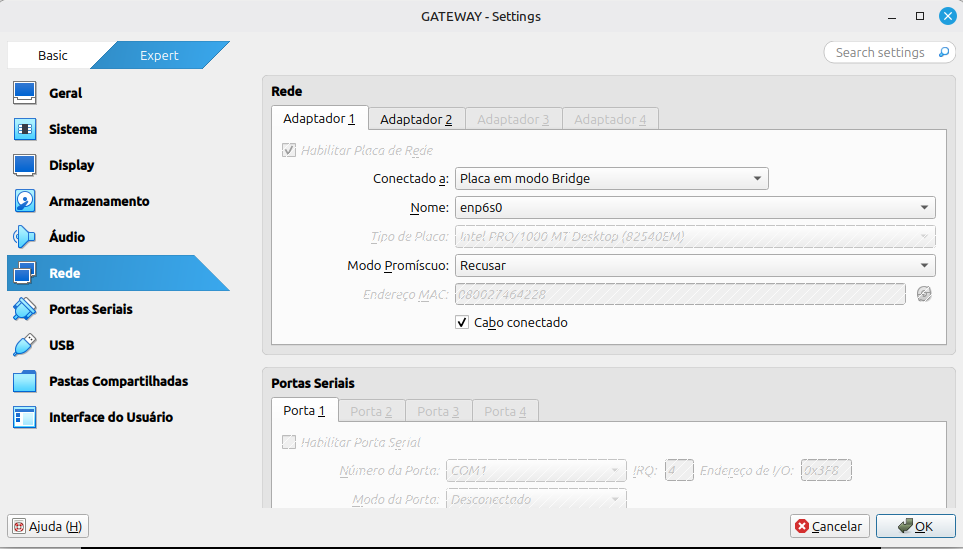
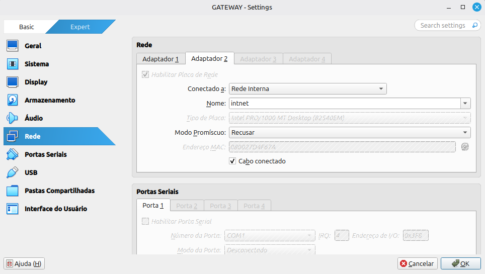
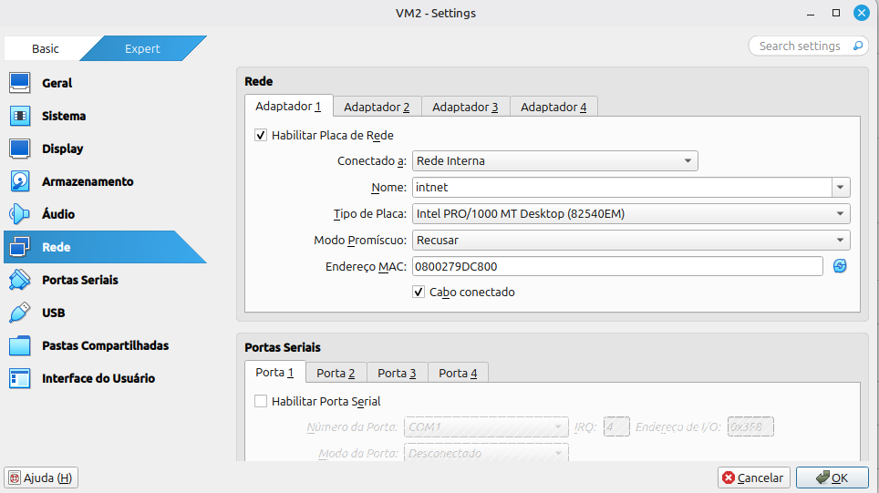
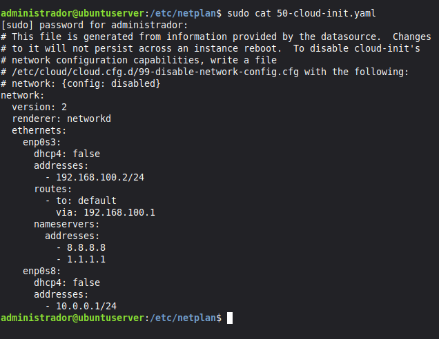
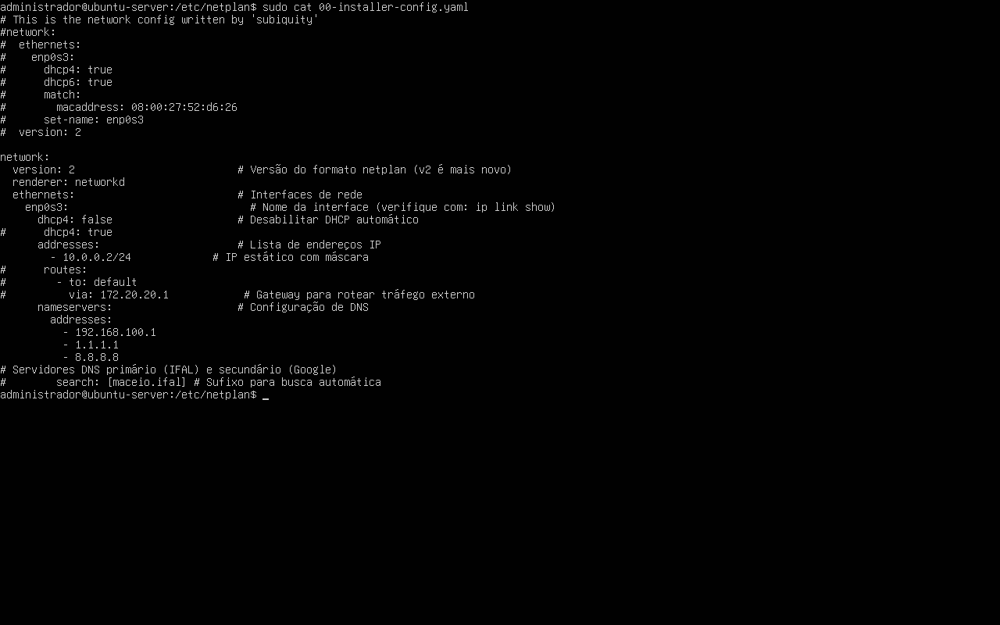
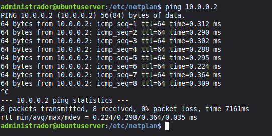

## 1. Identificação
* **Nome completo:** Matheus Willian do Nascimento Oliveira
* **Curso:** Sistemas de Informação
* **Turma:** 2023.1
* **Data:** 23/08/2026
* **Título da prática:** Aula Prática 07: Roteamento e Gateway NAT com IPTables e Rede Interna no VirtualBox

---

## 2. Objetivo

O objetivo desta prática laboratorial consistiu em configurar e compreender o funcionamento de um Servidor Gateway baseado em Linux Ubuntu Server, utilizando o NAT (Network Address Translation) e o mascaramento de IP com o IPTables para interconectar uma rede interna privada à Internet. Através desta abordagem, foi possível examinar como o gateway reescreve dinamicamente os endereços de origem dos pacotes provenientes da LAN, permitindo que múltiplos clientes partilhem um único endereço IP externo de forma transparente e eficiente.

---

## 3. Ambiente
* **Hardware Físico (Host):**
  * **Processador:** AMD Ryzen 5 5600GT
  * **Memória RAM:** 16 GB DDR4 (3200 MHz)
  * **Placa-mãe:** ASUS TUF Gaming A520M-Plus  
* **Virtualizador:** Oracle VM VirtualBox versão 7.1.18r173720
* **Imagem ISO Utilizada:** `ubuntu-22.04.5-live-server-amd64.iso`
* **Configurações da Máquina Virtual (GATEWAY):**
  * **Nome da VM:** `GATEWAY`
  * **Tipo / Versão:** Linux / Ubuntu (64-bit)
  * **Processador:** 1 vCPU
  * **Memória RAM:** 2048 MB 
  * **Armazenamento:** Disco rígido virtual de 32 GB 
  * **Controladora de Rede:** Interface em modo NAT (`enp0s3`) com DHCP ativo
* **Configurações da Máquina Virtual (VM2):**
  * **Nome da VM:** `VM2`
  * **Tipo / Versão:** Linux / Ubuntu (64-bit)
  * **Processador:** 1 vCPU
  * **Memória RAM:** 2048 MB 
  * **Armazenamento:** Disco rígido virtual de 32 GB 
  * **Controladora de Rede:** Interface em modo NAT (`enp0s3`) com DHCP ativo

## 4. Procedimento

O procedimento experimental iniciou-se com a configuração das interfaces de rede em modo Bridge e Rede Interna no VirtualBox, seguida da atribuição de endereços IP estáticos nos ficheiros Netplan da VM1 (Gateway) e da VM2 (Cliente). Posteriormente, procedeu-se à ativação do encaminhamento de pacotes no núcleo do sistema operacional através do parâmetro net.ipv4.ip_forward=1 e à aplicação das regras de mascaramento NAT com o IPTables na interface de saída da VM1, garantindo o correto encaminhamento e tradução do tráfego entre os dois segmentos de rede.

## 5. Testes e Validação

### Placa de rede 1 - adaptador 1  
  

### Placa de rede 1 - adaptador 2  
  

### Placa de rede 2 - adaptador 1  
  

### Conteúdo do arquivo netplan da VM1  
  

### Conteúdo do arquivo netplan da VM2  
  

### Ping da VM1 para VM2  
  

### Ping da VM2 para VM1  
  

### Ping da VM2 para outros endereços
  

## 6. Problemas e Soluções

Não foram encontrados problemas durante a execução dos passos do script.

## 7. Conclusão

A prática demonstrou que o roteamento NAT desempenha um papel fundamental na arquitetura de redes modernas, funcionando como um mecanismo essencial não só para a interconexão eficiente entre redes privadas e a Internet, mas também como uma importante ferramenta de segurança. Ao ocultar a topologia interna da LAN e gerir de forma centralizada o fluxo de dados, o gateway mitiga a exposição direta dos dispositivos locais, reforçando a proteção da rede contra acessos externos indesejados.

---