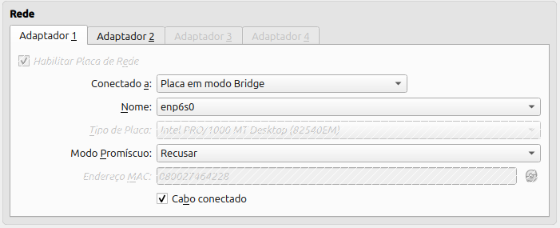
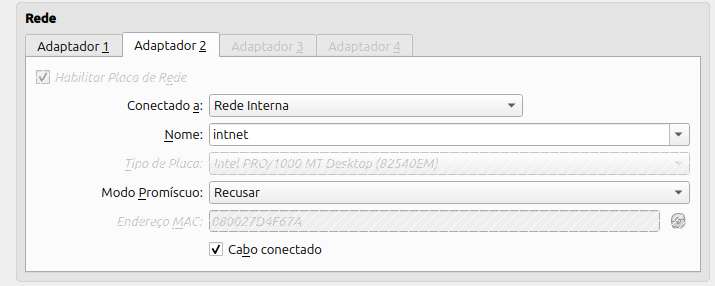
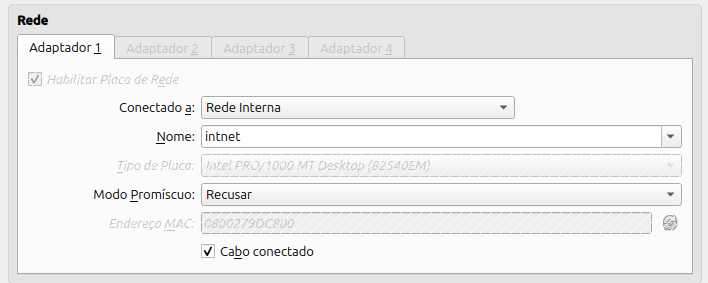
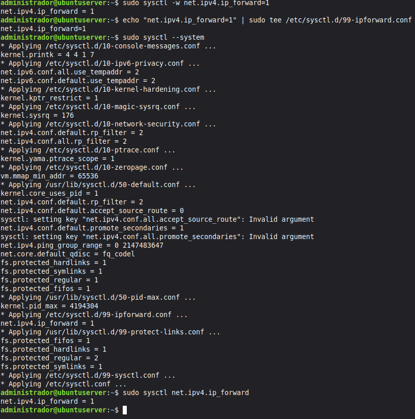
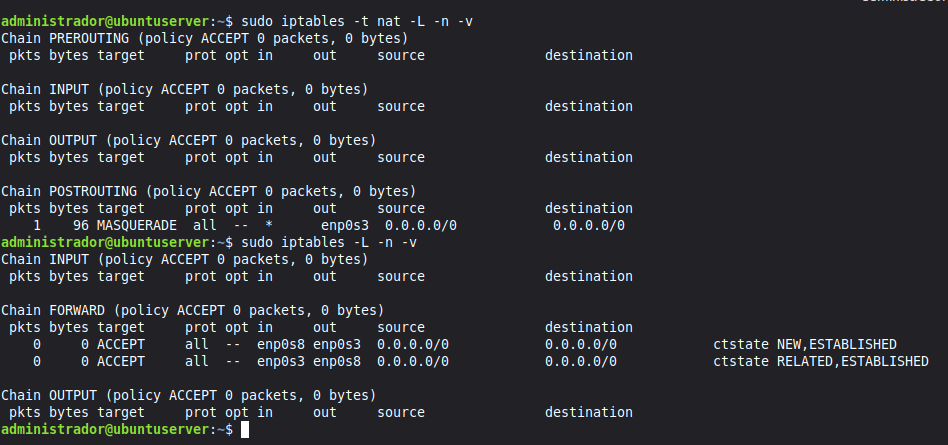
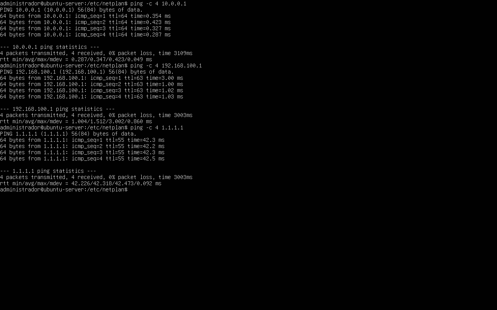
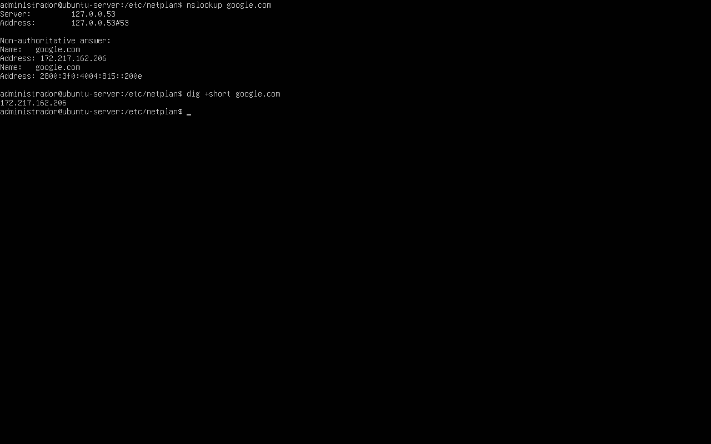
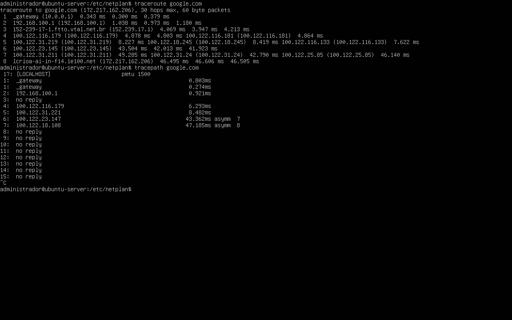

## 1. Identificação
* **Nome completo:** Matheus Willian do Nascimento Oliveira
* **Curso:** Sistemas de Informação
* **Turma:** 2023.1
* **Data:** 23/08/2026
* **Título da prática:** Aula Prática 06: Configuração de Rede Estática com Netplan e Modo Placa em Ponte (Bridge Adapter) no VirtualBox

---

## 2. Objetivo

Compreender e implementar a função de um Servidor Gateway em ambiente Linux (Ubuntu Server), configurando o encaminhamento de pacotes IP (ip_forward) e regras de tradução de endereços de rede (NAT / Mascaramento) através do IPTables. O laboratório visa permitir que uma máquina cliente isolada em uma rede interna privada (LAN) consiga comunicar-se com redes externas e com a Internet de forma transparente e segura, utilizando a VM1 como o seu roteador padrão.   

---

## 3. Ambiente
* **Hardware Físico (Host):**
  * **Processador:** AMD Ryzen 5 5600GT
  * **Memória RAM:** 16 GB DDR4 (3200 MHz)
  * **Placa-mãe:** ASUS TUF Gaming A520M-Plus  
* **Virtualizador:** Oracle VM VirtualBox versão 7.1.18r173720
* **Imagem ISO Utilizada:** `ubuntu-22.04.5-live-server-amd64.iso`
* **Configurações da Máquina Virtual (GATEWAY):**
  * **Nome da VM:** `GATEWAY`
  * **Tipo / Versão:** Linux / Ubuntu (64-bit)
  * **Processador:** 1 vCPU
  * **Memória RAM:** 2048 MB 
  * **Armazenamento:** Disco rígido virtual de 32 GB 
  * **Controladora de Rede:** Interface em modo NAT (`enp0s3`) com DHCP ativo
* **Configurações da Máquina Virtual (VM2):**
  * **Nome da VM:** `VM2`
  * **Tipo / Versão:** Linux / Ubuntu (64-bit)
  * **Processador:** 1 vCPU
  * **Memória RAM:** 2048 MB 
  * **Armazenamento:** Disco rígido virtual de 32 GB 
  * **Controladora de Rede:** Interface em modo NAT (`enp0s3`) com DHCP ativo

## 4. Procedimento

O procedimento prático foi executado sequencialmente nas duas máquinas virtuais da seguinte forma:

1. **Configuração de Hostnames:**
* Na **VM1**, definiu-se o nome de host para `vm1-gateway` através do comando `sudo hostnamectl set-hostname vm1-gateway`.
* Na **VM2**, definiu-se o nome de host para `vm2-cliente` utilizando o comando `sudo hostnamectl set-hostname vm2-cliente`.


2. **Habilitação do Encaminhamento de IP (VM1):**
* Ativou-se o encaminhamento de pacotes IPv4 de forma imediata (`sudo sysctl -w net.ipv4.ip_forward=1`) e persistente criando o arquivo de configuração em `/etc/sysctl.d/99-ipforward.conf`.


3. **Aplicação de Regras de NAT e IPTables (VM1):**
* Limparam-se as regras existentes e aplicou-se o mascaramento de saída na interface WAN (`enp0s3`):
```bash
sudo iptables -t nat -A POSTROUTING -o enp0s3 -j MASQUERADE
```


* Configuraram-se as regras de redirecionamento de tráfego (`FORWARD`) para permitir a saída da LAN para a WAN e o retorno de pacotes estabelecidos ou relacionados.


4. **Ajuste de Rota Padrão e DNS (VM2):**
* Atualizou-se o arquivo Netplan da **VM2** (`/etc/netplan/01-netcfg.yaml`) para garantir a atribuição do IP estático (`10.0.0.2/24`), os servidores DNS e a rota padrão apontando para o gateway interno (`via 10.0.0.1`), aplicando as alterações com `sudo netplan apply`.


5. **Persistência das Regras de Firewall (VM1):**
* Instalou-se o pacote `iptables-persistent` e executou-se o comando `sudo netfilter-persistent save` para garantir que as regras de NAT e IPTables fossem mantidas após reinicializações do sistema.


6. **Bateria de Testes de Conectividade:**
* Executaram-se testes de `ping` (para o gateway interno, IP externo e IP público `1.1.1.1`), resolução de nomes com `nslookup google.com` e rastreamento de rotas a partir da VM2 para validar o sucesso do roteamento NAT.
---

## 5. Testes e Validação

### Configuração de rede VM1  

  
  

### Configuração de rede VM2  

   

### Sysctl da VM 1  

   

### Saída das regras do Iptables  

    

### Ping para endereços IP externos  

   

### NSLOOKUP  

   

### TRACEROUTE  

   

## 6. Problemas e Soluções

Não foram encontrados problemas durante a execução dos passos do script.

## 7. Conclusão

A prática da Aula 08 permitiu consolidar os conceitos fundamentais de roteamento, tradução de endereços de rede e controlo de tráfego em sistemas Linux. Verificou-se que, sem o encaminhamento de pacotes (ip_forward) e o mascaramento via IPTables no gateway, os nós de uma rede interna privada ficam limitados à comunicação local. A implementação bem-sucedida demonstrou a importância de estruturar adequadamente as rotas estáticas nas máquinas clientes e de garantir a persistência das regras de segurança e NAT, simulando com precisão o comportamento de um roteador de borda em ambientes corporativos ou residenciais.

---